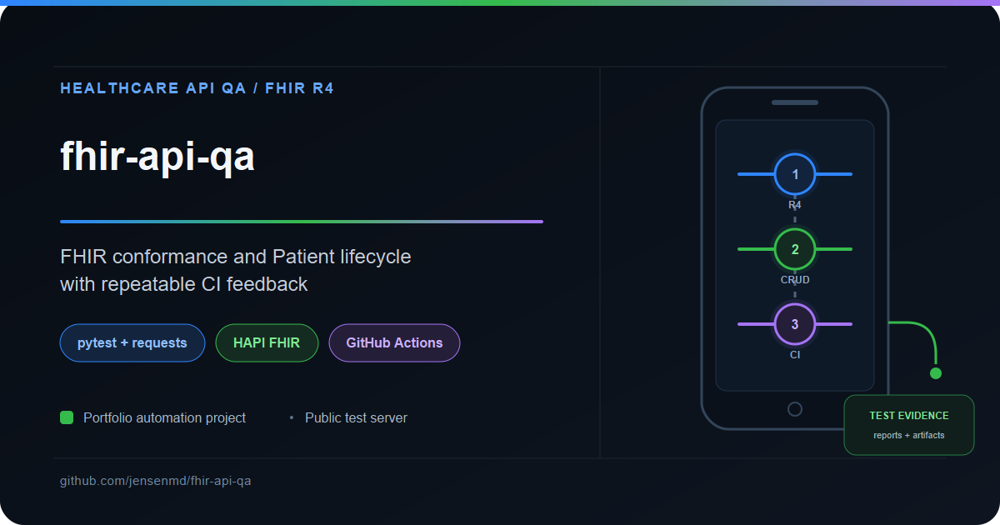

# fhir-api-qa

A QA portfolio project targeting the public HAPI FHIR R4 test server — an open-source implementation of HL7 FHIR, the interoperability standard behind modern healthcare data exchange. This project demonstrates backend API quality engineering for healthcare systems: server conformance checks, resource lifecycle testing, and negative-case validation, configured to run in CI on pushes and pull requests to `main`.




Built by **Michael D. Jensen** — Senior QA Engineer with 15+ years of enterprise testing experience, specializing in API testing, automation, and CI/CD-integrated quality practices.

🔗 [LinkedIn](https://www.linkedin.com/in/michaeljensen-qa/) | 📧 jensen.md@gmail.com

---

## What This Project Demonstrates

| Layer | Stack | Coverage |
|---|---|---|
| Server Conformance | pytest + requests | CapabilityStatement validation, FHIR R4 version check, resource support |
| Patient Lifecycle | pytest + requests | Full CRUD: create, read (round-trip), update, search, delete |
| Negative Cases | pytest + requests | Malformed input rejected with `OperationOutcome`, never 500s |
| CI/CD Pipeline | GitHub Actions | Full suite on main pushes/PRs, weekly schedule, and manual dispatch |

This is a backend-only project by design. FHIR quality lives at the API and data layers — selected field integrity, search semantics, and error contracts — so every test targets the layer where healthcare interoperability actually breaks.

---

## Why HAPI FHIR?

[HAPI FHIR](https://hapi.fhir.org/) is the open-source reference implementation of HL7 FHIR, maintained by Smile CDR and used across the healthcare industry. Its public test server provides:

- A real FHIR R4 API with the full resource lifecycle (create, read, update, delete, search)
- A CapabilityStatement endpoint declaring exactly what the server supports
- Strict validation behavior — malformed resources are rejected with structured `OperationOutcome` errors
- Enough realism to write meaningful tests without requiring access to a production EHR

It's the closest thing the QA community has to a standard practice target for healthcare interoperability testing — it behaves like a real clinical data server, including the quirks of shared public infrastructure.

---

## Project Structure

```
fhir-api-qa/
├── .github/
│   └── workflows/
│       └── ci.yml                  # Runs pytest on push/PR + weekly schedule
├── tests/
│   ├── conftest.py                 # Client fixture, unique test data, cleanup
│   ├── test_server_capabilities.py # CapabilityStatement smoke tests
│   ├── test_patient_crud.py        # Patient lifecycle: CRUD + search + delete
│   ├── test_negative_cases.py      # Malformed input, error contracts
│   └── unit/                       # Offline hardening regression checks
├── utils/
│   ├── fhir_client.py              # Thin FHIR R4 client wrapper
│   ├── patient_cleanup.py          # ID tracking and teardown diagnostics
│   └── patient_search.py           # Isolated, bounded indexing wait
├── conftest.py                    # Serial smoke ordering and failure gate
├── pytest.ini                     # Strict markers and test discovery
├── assets/                        # Editable portfolio card source
├── TEST_PLAN.md                    # Test strategy, scope, risk areas
├── requirements.txt
├── fhir-api-qa-project-card.png
└── README.md
```

---

## Test Coverage

### Server Capabilities

| Check | What's Validated |
|---|---|
| CapabilityStatement | Endpoint returns valid FHIR JSON with `resourceType: CapabilityStatement` |
| FHIR version | Server declares FHIR R4 (`fhirVersion` equals `4.0.1`) |
| Resource support | Server-mode Patient create/read/update/delete/search and token identifier search |

These smoke tests run first and stop the remaining selected suite on failure.

### Patient Lifecycle

| Operation | What's Validated |
|---|---|
| Create | `201 Created` with server-assigned id |
| Read | Round-trip integrity — what you wrote is what you read back |
| Update | Changes persist on re-read |
| Search | Exact `identifier=system|value` search finds only the created Patient; bounded indexing wait |
| Delete | Resource removed; subsequent read returns `404`/`410`, never the record |

### Negative Cases

| Input | Expected |
|---|---|
| Invalid `birthDate` (`"not-a-date"`) | `400`/`422` with `OperationOutcome` |
| Read of nonexistent id | `404` |
| Unknown `resourceType` | `400`/`404`, never a `500` |

The error contract matters as much as the happy path. A FHIR server that silently accepts malformed clinical data is a patient-safety issue, not just a test failure.

---

## Test Data Isolation

Every test that creates a Patient uses a full UUID identifier and registers its returned ID for fixture teardown before assertions. This includes unexpectedly accepted invalid Patient payloads. The public HAPI server is shared infrastructure — tests must never depend on pre-existing data, collide with each other, or leave debris behind. Tests own their data and do not rely on execution order. Parallel execution is not configured or verified; the smoke gate applies to the selected tests in a serial pytest run. (See `TEST_PLAN.md` for the full strategy.)

---

## CI/CD Pipeline

GitHub Actions is configured to run on pushes and pull requests to `main`, plus a weekly Monday schedule as a health check:

- **pytest job** — installs pinned dependencies and runs selected smoke tests first. A failed smoke check stops the remaining suite with a nonzero exit. Other failures do not stop unrelated tests.
- **Reports** — JUnit XML and a self-contained HTML report are uploaded with `if: always()` and retained for 14 days, including failing runs that reached pytest.
- **Triggers** — pushes/PRs to `main`, Monday 09:00 UTC, and manual dispatch. The job has a 15-minute timeout; automatic concurrency cancellation is disabled to allow teardown.

> **Note on CI stability:** The public HAPI FHIR server is shared infrastructure with variable latency. Timeouts are set generously and capability smoke tests fail fast, and request errors include diagnostics for triage — the same triage discipline as any external-dependency pipeline: a failure still requires investigation; the suite does not automatically classify its cause or turn it into a pass.

---

## Running Locally

### Prerequisites
- Python 3.10+

### Run the suite
```bash
python -m venv .venv && source .venv/bin/activate
pip install -r requirements.txt
python -m pytest -v --junitxml=reports/junit.xml --html=reports/pytest-report.html --self-contained-html
```

Validated locally on Python 3.12.10; CI targets Python 3.12. On Windows, activate with `.venv\Scripts\Activate.ps1`. To run offline regression checks: `python -m pytest -m unit -v`. Set `FHIR_BASE_URL` to use another compatible disposable FHIR R4 server. Running a subset without smoke tests bypasses the gate.

Search retries only valid empty search Bundles (10 attempts, 2 seconds apart); HTTP errors, invalid Bundles, unrelated results, and duplicate matches fail immediately. Each HTTP call has a 30-second timeout; slow requests can extend the indexing wait beyond 18 seconds.

Cleanup attempts every registered ID and reports failures as teardown errors. If the server accepts a write but the connection loses its response, no returned ID is available. Process termination, CI cancellation, or server outages can also prevent cleanup. Use only synthetic data; deletion does not purge server history.

The checks cover selected fields and server behavior, not full FHIR schema validation, clinical safety certification, or production EHR interoperability.

---

## QA Portfolio Quick Reference

This project is part of a broader QA portfolio demonstrating complementary quality-engineering skills.

| Project | Focus |
|---|---|
| [android-appium-wdio-poc](https://github.com/jensenmd/android-appium-wdio-poc) | Native Android UI automation proof of concept using Appium, WebdriverIO, TypeScript, and UiAutomator2 |
| [mapmyrun-quality-investigation](https://github.com/jensenmd/mapmyrun-quality-investigation) | Black-box mobile and GPS quality investigation using field evidence and bounded conclusions |
| [restful-booker-qa](https://github.com/jensenmd/restful-booker-qa) | Layered API and UI automation using Postman, Newman, Playwright, and GitHub Actions |
| [pharmacy-spend-etl-qa](https://github.com/jensenmd/pharmacy-spend-etl-qa) | ETL pipeline and SQL-driven data-integrity validation modeled after healthcare analytics work |
| [qa-automation-showcase](https://github.com/jensenmd/qa-automation-showcase) | REST API testing, data validation, and CI/CD-integrated automation |
| [ai-qa-framework](https://github.com/jensenmd/ai-qa-framework) | Human-reviewed AI-assisted test generation with structured cases and pytest execution |
| [claude-code-qa-sessions](https://github.com/jensenmd/claude-code-qa-sessions) | Agentic analysis of existing QA repositories with human review and targeted implementation |
| [agentqa-orchestrator](https://github.com/jensenmd/agentqa-orchestrator) | Structured agentic code auditing using Python, Pydantic, Gemini, and JSON |
| [fhir-api-qa](https://github.com/jensenmd/fhir-api-qa) **(this repository)** | FHIR R4 API testing with pytest against the public HAPI FHIR server — CapabilityStatement checks, Patient CRUD, negative cases, GitHub Actions CI |

---

## Author

**Michael D. Jensen** — Senior QA Engineer
15+ years of enterprise software testing experience across healthcare IT, financial systems, telecommunications, and cybersecurity. Deep background in REST API validation, ETL pipeline testing, SQL-based data integrity verification, and full-stack manual testing in Agile environments.

Current hands-on work includes Python/pytest automation, Playwright UI testing, and CI/CD-integrated quality practices.

🔗 [LinkedIn](https://www.linkedin.com/in/michaeljensen-qa/) | 🐙 [GitHub Profile](https://github.com/jensenmd) | 📧 jensen.md@gmail.com

## Portfolio Card Source

`assets/project-card.svg` reconstructs the 1200 × 630 layout of the reference `restful-booker-qa-project-card.png`. No editable source/template was present in the three reference repositories. The FHIR card preserves the reference geometry, dark background, blue/green/purple accents, badges, footer, and three-stage diagram, with FHIR-specific labels. `assets/render_card.py` renders the SVG to the README PNG using CairoSVG (`python -m pip install -r assets/requirements.txt`, then `python assets/render_card.py`). Rendering requires native Cairo (Windows users may need its DLLs on PATH). The SVG uses Arial; exact font rendering depends on the installed fonts.
